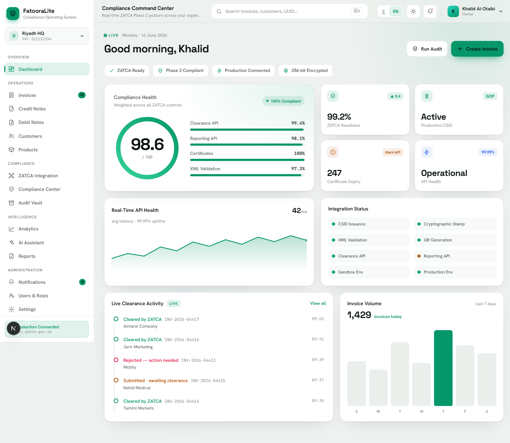
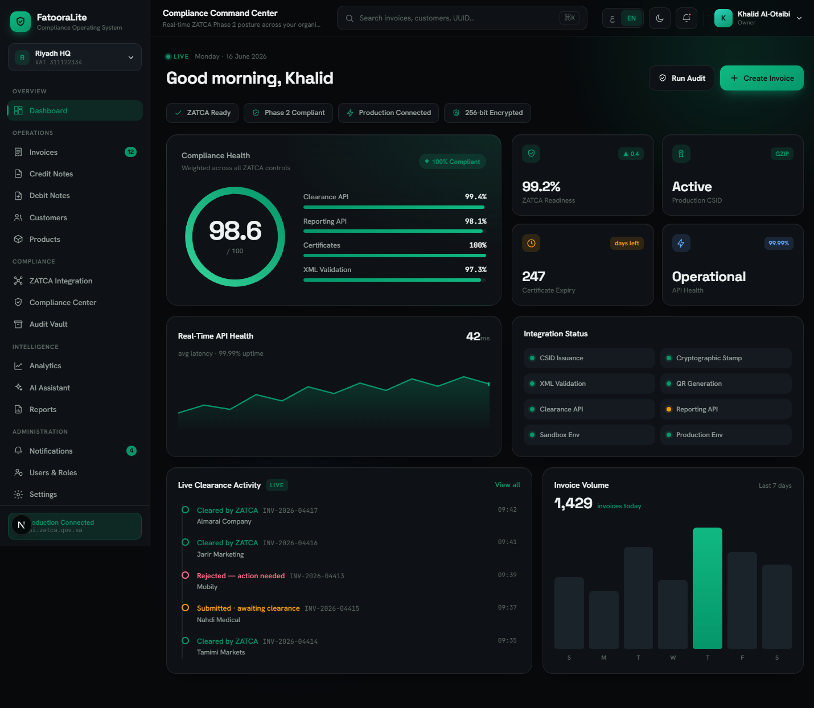

<p align="center"></p>

# FatooraLite

FatooraLite is a multi-tenant invoicing application for Saudi business workflows. Its code combines customer/product records, invoice operations, signing and XML utilities, onboarding, role permissions, and audit-related services in a Next.js application backed by Prisma and PostgreSQL. Arabic and English screens support different reading directions. Integration code and local signature validation are inspectable engineering work; they do not establish regulatory certification or a successful production clearance round trip.

[](https://github.com/ak1458/fatooralite/stargazers)
[](https://github.com/ak1458/fatooralite/watchers)
[](https://github.com/ak1458/fatooralite/forks)
[](https://github.com/ak1458/fatooralite/activity)
[](LICENSE)

**[How it works](#how-it-works) · [Run locally](#run-locally) · [Configuration](#configuration) · [Commands](#development-commands) · [Versions](#versions-and-distribution) · [License](#license)**

## Interface preview

The following images are existing repository captures; they are not a new acceptance run.





## How it works

1. Register a company, complete the application’s onboarding, and work within its tenant and role boundaries.
2. Maintain customers/products, create invoice data, and pass it through the domain calculations and signing pipeline.
3. Use the configured ZATCA mode and certificate/onboarding workflow for submission and reconciliation.
4. Inspect invoice state, audit information, and operations screens; use the production checklist before introducing live customer data.

## Architecture

| Path | Purpose |
| --- | --- |
| [fatooralite/lib/zatca/](<fatooralite/lib/zatca/>) | Invoice XML, signing, and compliance-engine code. |
| [fatooralite/lib/](<fatooralite/lib/>) | Database, service, billing, authorization, and provider layers. |
| [fatooralite/app/](<fatooralite/app/>) | Application screens and API handlers. |
| [fatooralite/prisma/](<fatooralite/prisma/>) | Database schema and migrations. |
| [docs/audit/](<docs/audit/>) | Recorded audit findings, decisions, and remediation status. |
| [docs/](<docs/>) | Architecture, deployment, incident, and backup procedures. |

## Product and engineering

- Invoice creation, credit/debit notes, customer and product management.
- XML generation/signing, CSID onboarding, and clearance/reporting integration code.
- Arabic/English interface, role permissions, and tenant-scoped services.
- Prisma persistence, audit events, and a provider-based assistant layer.


## Run locally

```bash
git clone https://github.com/ak1458/fatooralite.git
cd fatooralite/fatooralite
npm install
cp .env.example .env
```

Set up a development PostgreSQL database and the required secrets, then run:

```bash
npm run db:migrate
npm run dev
```

The application lives in **`fatooralite/`**. Keep that directory as the deployment root. New installations require company registration; demo seeding is optional and for development only.

## Architecture and checks

`lib/zatca` → database repositories → services → API routes → application screens.

Available checks inside `fatooralite/`: `npm run lint`, `npm test`, `npm run zatca:validate`, `npm run test:e2e`, and `npm run build`. Database tests require the separate test database and isolation convention in [START-HERE.md](START-HERE.md).

## Current limits

The checked-in handoff records an outstanding real ZATCA round trip requiring the owner's portal OTP, alongside other production gates. Local signing and integration code do not establish regulatory certification or production clearance. Read [current state](START-HERE.md) and [the production checklist](docs/18-production-checklist.md) before a live rollout.


## Configuration

Settings template: [fatooralite/.env.example](<fatooralite/.env.example>). Copy it to the application’s local environment file and fill only the integrations you use.

| Variable | Purpose |
| --- | --- |
| `DATABASE_URL` | Database connection used by the server or ORM. |
| `DIRECT_URL` | Direct database connection for the Prisma workflow. |
| `AUTH_SECRET` | Server-side session signing secret. |
| `ZATCA_MODE` | Select the documented sandbox/production integration mode. |
| `ZATCA_SANDBOX_BASE_URL` | Endpoint for the corresponding integration; verify the expected service and environment. |
| `ZATCA_PRODUCTION_BASE_URL` | Endpoint for the corresponding integration; verify the expected service and environment. |

Environment files and provider tokens must remain untracked. A public client prefix exposes a value in the browser bundle; it is not a safe place for privileged credentials.

## Development commands

Workspace: [fatooralite/package.json](<fatooralite/package.json>). Run these commands from its directory.

| Command | Script defined in manifest |
| --- | --- |
| `npm run dev` | `next dev` |
| `npm run build` | `next build` |
| `npm run start` | `next start` |
| `npm run lint` | `eslint` |
| `npm run test` | `vitest run` |
| `npm run test:watch` | `vitest` |
| `npm run test:e2e` | `playwright test` |
| `npm run db:push` | `prisma db push` |
| `npm run db:migrate` | `prisma migrate deploy` |
| `npm run db:migrate:dev` | `prisma migrate dev` |
| `npm run db:generate` | `prisma generate` |
| `npm run db:seed` | `tsx prisma/seed.ts` |
| `npm run db:studio` | `prisma studio` |
| `npm run docs:build` | `node scripts/build-docs.mjs` |
| `npm run zatca:validate` | `tsx scripts/validate-zatca.ts` |
| `npm run ai:ingest-global` | `tsx scripts/ingest-global.ts` |
| `npm run postinstall` | `prisma generate` |

These are available commands, not a claim that all checks passed in this documentation pass. Connected checks require the services, credentials, and isolated data described above.

## Operational notes

Run commands from the nested fatooralite/ application directory. Database tests must follow the isolation convention in START-HERE.md: schema-pushing files cannot all race against one database. Use an isolated test database and do not seed/reset a live tenant. The checked-in handoff explicitly records outstanding owner-dependent production gates, including the real ZATCA round trip. Required CI currently reports dependency-audit failures; do not replace that gate with a static “passing” badge.

## Troubleshooting

| Symptom | What to check |
| --- | --- |
| Prisma cannot connect or a table is missing | Check development DATABASE_URL/DIRECT_URL and apply the repository migrations to the intended database. |
| Tests race or affect each other | Read the separate-schema/test-isolation instructions in START-HERE.md before using a shared TEST_DATABASE_URL. |
| Signing works but clearance fails | Local cryptography does not supply valid company credentials, OTP, or CSID onboarding; follow the production integration checklist. |

## Versions and distribution

Manifest versions are application/workspace metadata, not a certification of release readiness.

| Manifest | Declared version |
| --- | --- |
| [fatooralite/package.json](<fatooralite/package.json>) | `0.4.0` |

The repository has source tags (`v0.4.0`, `v0.3.0`, `v0.2.0`, `v0.1.0`), but no published GitHub Release was recorded in this snapshot. [Browse tags](https://github.com/ak1458/fatooralite/tags). Tags and release notes are separate objects.

GitHub Packages is a separate registry. This README does not imply that a registry package exists; use the installation path documented here rather than an invented package-install command.

## Documentation and maintenance

- [START-HERE.md](<START-HERE.md>)
- [docs/README.md](<docs/README.md>)
- [docs/18-production-checklist.md](<docs/18-production-checklist.md>)
- [docs/19-operations-runbook.md](<docs/19-operations-runbook.md>)
- [docs/21-backup-restore.md](<docs/21-backup-restore.md>)

Include the affected workflow, reproduction steps, and relevant check output when reporting a problem. Do not include credentials or live customer data.

## License

This repository’s project code is **proprietary / all rights reserved**. Public visibility does not grant unrestricted reuse. Read [LICENSE](<LICENSE>) for the exact terms. Third-party dependencies and bundled components retain their own notices.
